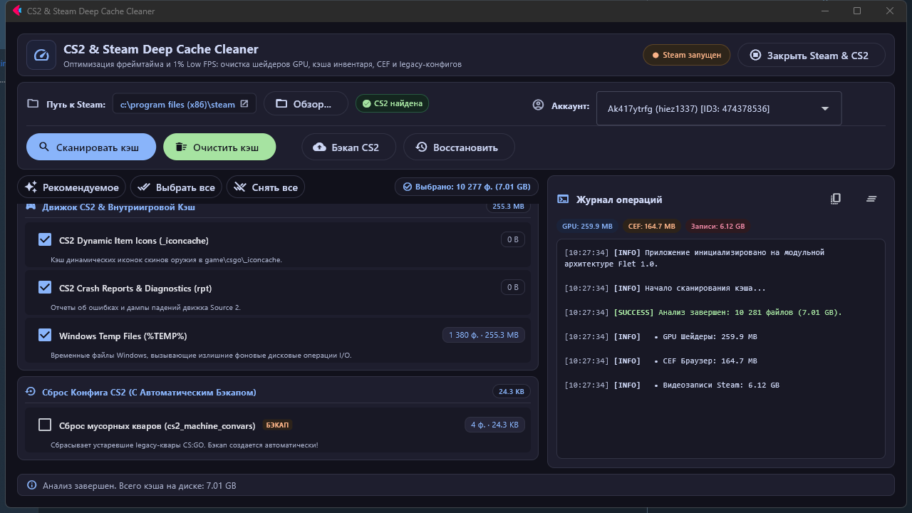

# CS2 & Steam Deep Cache Cleaner

[](https://github.com/hiez1337/SteamCleaner/releases)
[](https://www.python.org/)
[-blue?style=flat-square&color=a6e3a1)](https://flet.dev/)
[](LICENSE)
[](https://www.microsoft.com/)

Современная высокопроизводительная утилита для глубокого анализа и безопасной очистки фрагментированных дисковых кэшей **Steam**, **Counter-Strike 2**, видеокарт **NVIDIA / AMD** и **DirectX**.

Разработана для устранения микрофризов, стабилизации времени кадра (frametime) и повышения показателя **1% Low FPS**.

---



---

## ⚡ Почему игра идет плавнее на чистом кэше?

1. **Фрагментация бинарников шейдеров (`DXCache` / `GLCache`):** Со временем папки кэша видеодрайвера накапливают устаревшие скомпилированные шейдеры (`.nvbx`) от старых версий игры и драйверов. При обращении к поврежденным или фрагментированным блокам во время взрывов гранат и смоков возникают задержки обращения к диску (stuttering).
2. **Фоновая запись Steam (`gamerecordings`):** Встроенная функция записи геймплея незаметно накапливает от 5 до 20+ ГБ временных видеофрагментов в папке аккаунта, постоянно нагружая NVENC/VCE кодировщик видеокарты и дисковую подсистему.
3. **CEF Браузер Steam (`htmlcache`):** Процессы `steamwebhelper.exe` кэшируют гигабайты веб-ресурсов торговой площадки и сообщества, вызывая избыточное фоновое потребление RAM и CPU.
4. **Устаревшие переменные (`cs2_machine_convars.vcfg`):** На старых аккаунтах сохраняются неактуальные квары со времен CS:GO, конфликтующие с сетевым конвейером и движком Source 2.

---

## 🚀 Возможности и компоненты очистки

| Категория | Объекты очистки | Влияние на производительность |
|---|---|---|
| **GPU & DirectX Кэш Шейдеров** | NVIDIA DXCache, GLCache, ComputeCache, DirectX D3DSCache, AMD DxCache | Устранение фризов при первом появлении дыма, вспышек и гранат. |
| **Steam CEF & Web Браузер** | htmlcache, appcache httpcache, librarycache, logs | Снижение фоновой нагрузки процесса `steamwebhelper.exe` на CPU и память. |
| **Кэш Аккаунта Steam** | Буфер видеозаписи `gamerecordings`, кэш инвентаря `inventorymsgcache`, UGC workshop, `socache.dt`, телеметрия `pet` | Освобождение от 2 до 10+ ГБ места, ускорение отклика инвентаря в Panorama UI. |
| **Движок CS2 & Внутриигровой Кэш** | Динамические иконки скинов `_iconcache`, отчеты о падениях `rpt`, системный `%TEMP%` | Устранение задержек загрузки скинов и очистка временных дисковых файлов. |
| **Сброс Конфига CS2 (Safe)** | `cs2_machine_convars.vcfg`, `remotecache.vdf` (с **автоматическим ZIP-бэкапом**) | Сброс мусорных legacy-кваров с возможностью восстановления в 1 клик. |

---

## 🛡️ Безопасность и защита данных

- **Автоматический бэкап:** При выборе сброса кваров утилита автоматически архивирует всю директорию пользовательских настроек CS2 (`userdata/<SteamID3>/730`) в папку `backups/`.
- **Восстановление в 1 клик:** Встроенная функция «Восстановить» позволяет быстро вернуть конфигурацию из любого ранее созданного архива с подтверждением через модальный диалог.
- **Process Guard:** Утилита отслеживает запущенные процессы Steam и CS2 в реальном времени и предупреждает о необходимости их закрытия перед очисткой для предотвращения блокировки файлов (`ERROR_SHARING_VIOLATION`). Доступно принудительное завершение всех процессов в 1 клик.

---

## 🏗️ Архитектура проекта

Проект построен по модульным стандартам **Flet 1.0 (Flutter for Python)**:

- `core/models.py` — типизированные структуры данных (`CacheItem`, `AccountInfo`, `ScanStats`, `CleanResult`).
- `core/hardware.py` — автоматическое обнаружение путей Steam, библиотек CS2 и аккаунтов через реестр Windows и парсинг `.vdf`.
- `core/process_guard.py` — неблокирующий асинхронный мониторинг и завершение процессов.
- `core/cleaner_engine.py` — потокобезопасный сканер и движок очистки кэша (`asyncio.to_thread`).
- `core/backup_service.py` — ZIP-архиватор и валидатор бэкапов конфигураций.
- `ui/theme.py` — тема Material 3 Dark (Catppuccin Mocha) с семантическими дизайн-токенами.
- `ui/state.py` — централизованный реактивный `AppState`.
- `ui/components/` — независимые компоненты (`HeaderBar`, `ConfigBar`, `CacheCategoryCard`, `CacheItemTile`, `ConsoleView`, `FooterBar`).
- `ui/dialogs/` — модальные диалоги подтверждения очистки и восстановления.

---

## 📦 Установка и запуск

### Вариант 1: Готовый исполняемый файл (Без установки Python)
Скачайте актуальный `SteamCleaner.exe` со страницы [Releases](https://github.com/hiez1337/SteamCleaner/releases) и запустите его.

### Вариант 2: Запуск из исходного кода
Требуется **Python 3.12+**:

```bash
# Клонируйте репозиторий
git clone https://github.com/hiez1337/SteamCleaner.git
cd SteamCleaner

# Установите зависимости
pip install -r requirements.txt

# Запустите интерфейс
python steam_cleaner_flet.py
# или дважды щелкните run_cleaner.bat
```

### Вариант 3: Самостоятельная сборка EXE через `flet pack`

```bash
pip install pyinstaller flet-cli
flet pack steam_cleaner_flet.py --name SteamCleaner --product-name "CS2 & Steam Deep Cache Cleaner" --file-description "CS2 & Steam Deep Cache Cleaner" --product-version "1.0.0" --file-version "1.0.0.0" --yes
```

Собранный файл будет находиться в директории `dist/SteamCleaner.exe`.

---

## ⚙️ Автоматическая сборка (CI/CD)

В репозиторий встроен workflow **GitHub Actions** (`.github/workflows/release.yml`):
- При пуше тега `v*` (например, `git tag v1.0.0 && git push --tags`) автоматически запускается раннер `windows-latest`.
- Устанавливается чистый стек зависимостей и утилита `flet pack`.
- Генерируется оптимизированный `SteamCleaner.exe` и ZIP-архив.
- Автоматически публикуется релиз на GitHub с прикрепленными бинарниками и журналом изменений.

---

## 📄 Лицензия

Распространяется под лицензией [MIT](LICENSE). Разработано [Andrey Titkov (hiez1337)](https://github.com/hiez1337).
